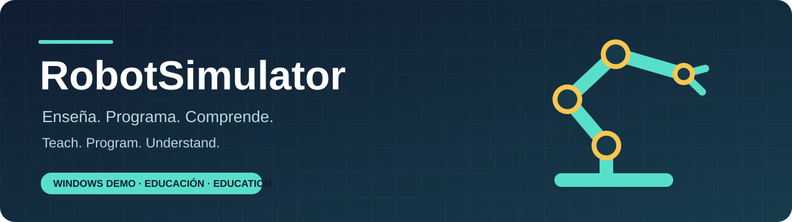
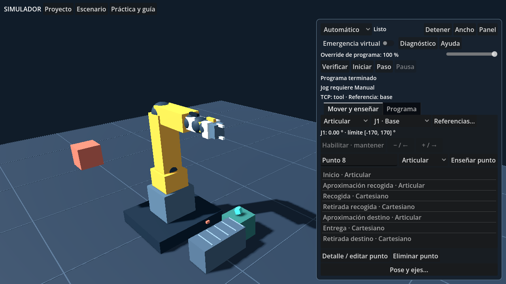
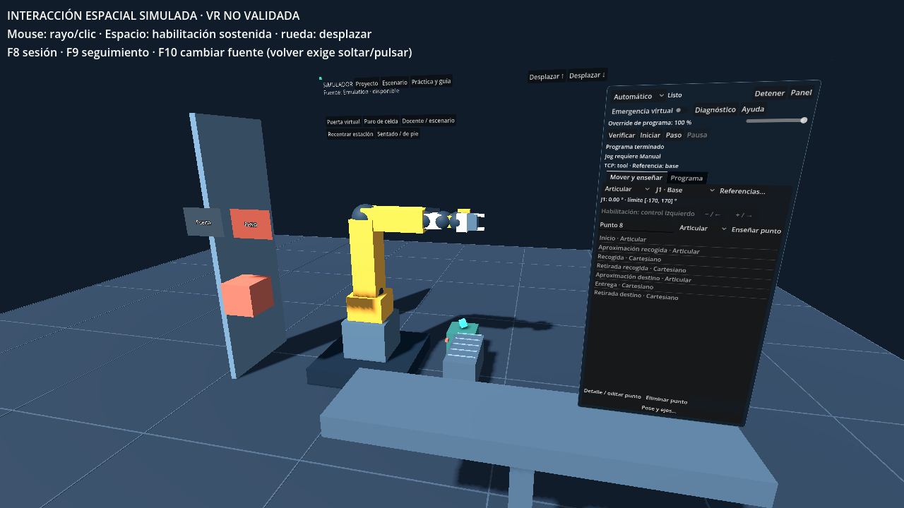
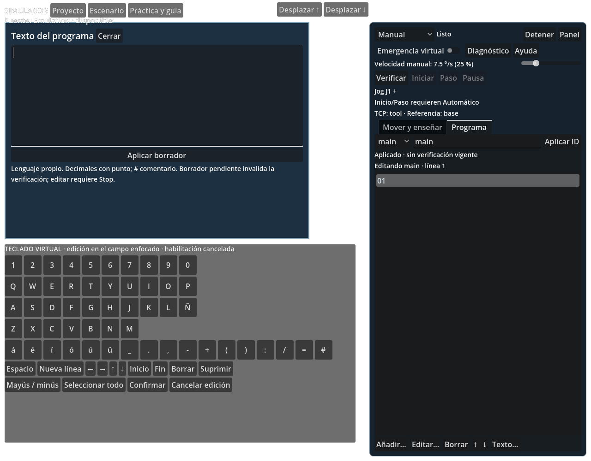

<p align="center">
  
</p>

<p align="center">
  <strong>Robótica industrial para aprender haciendo.</strong><br>
  Una celda virtual para enseñar puntos, escribir programas y entender cómo se recupera una operación.
</p>

<p align="center">
  <a href="README.md">Español</a> · <a href="README.en.md">English</a> ·
  <a href="docs/DEMO_GUIDE.md">Probar la demo</a> · <a href="docs/STATUS.md">Estado del proyecto</a>
</p>

---

## De la primera posición al primer ciclo

**RobotSimulator es una demo educativa para Windows.** El alumno trabaja con un robot virtual de seis ejes y un panel de programación —teach pendant— para practicar fundamentos que después puede aplicar al conocer equipos de distintas marcas.

La propuesta es aprender qué significa mover, enseñar, programar y recuperar una celda. La interfaz usa términos generales y mantiene visibles el modo de operación, la ejecución y las alarmas.



## Lo que puedes practicar hoy

| Experiencia | Qué haces |
|---|---|
| **Mover y enseñar** | Seleccionas ejes o movimiento cartesiano, mantienes la habilitación y guardas puntos. |
| **Elegir referencias** | Configuras la herramienta y el sistema de referencia del movimiento. |
| **Programar** | Combinas movimientos, esperas, señales, condiciones, repeticiones y subprogramas. |
| **Ejecutar y observar** | Verificas el programa, avanzas por pasos o ejecutas un ciclo de recogida y entrega. |
| **Diagnosticar y recuperar** | Revisas sensores, alarmas y eventos; retiras la causa y restableces sin rearranque automático. |
| **Guardar tu trabajo** | Conservas puntos, referencias y programas en proyectos JSON locales. |

## Dos formas de probarla, un mismo robot

**Escritorio:** cámara orbital, mouse y teclado. Es el punto de entrada recomendado para comenzar.

**Interacción espacial simulada:** panel situado en el mundo, selección por rayo y teclado virtual. Permite probar la ruta de interacción inmersiva sin disponer de visor.



> **Estado de VR:** existe un adaptador OpenXR para visores conectados a PC. Su funcionamiento con hardware sigue pendiente de validación. La emulación espacial no es una prueba de VR ni garantiza compatibilidad con todos los visores.

## Pruébala en 10 minutos

Si ya tienes el paquete Windows:

1. Descomprime **la carpeta completa**; el ejecutable necesita los archivos que lo acompañan.
2. Abre `RobotSimulator.exe` y elige **Escritorio**.
3. En **Práctica y guía**, carga el ejemplo editable.
4. Revisa sus puntos y programa; selecciona **Automático**, verifica e inicia el ciclo.
5. Consulta [primeros pasos](docs/DEMO_GUIDE.md) para probar una falla y completar la recuperación.

La descarga del código fuente no incluye el ejecutable. Para generar tu paquete Windows, sigue [desarrollo y compilación](docs/DEVELOPMENT.md); el resultado se guarda en `exports/windows-release-immersive/`.

El paquete es Windows x64 autocontenido: no necesita el editor Godot ni instalar .NET para ejecutarse. No requiere cuenta ni conexión durante la práctica. La ejecución se ha comprobado en el equipo de desarrollo; falta validarla en otra PC limpia. [Requisitos y alcance](docs/REQUIREMENTS.md).

## Explorar el ciclo completo

La demo permite practicar **una operación correcta y una falla recuperable**. Además de observar el movimiento, se pueden revisar la referencia, el punto, la instrucción activa y la condición que permite continuar.

El panel separa **Mover y enseñar** de **Programa**. Las funciones de ejecución y seguridad permanecen accesibles, y el teclado virtual permite editar dentro de la ruta espacial.

<details>
<summary>Ver el teclado virtual</summary>



</details>

## Para desarrollar

El núcleo está escrito en **C#**, independiente de Godot. **Godot .NET** representa la celda y recibe la interacción. Escritorio y ruta espacial comparten cálculo, programas y estados.

Entorno comprobado: **Godot .NET 4.7.2**, **.NET SDK 10.0.401** y Windows x64. Los paquetes están fijados; no hay dependencias esenciales de pago. Los scripts aceptan `-GodotPath` cuando la instalación está en otra ubicación.

```powershell
powershell -NoProfile -ExecutionPolicy Bypass -File scripts/Build-And-Test.ps1 -GodotPath "C:\ruta\Godot_console.exe"
powershell -NoProfile -ExecutionPolicy Bypass -File scripts/Export-Demo.ps1 -GodotPath "C:\ruta\Godot_console.exe"
powershell -NoProfile -ExecutionPolicy Bypass -File scripts/Smoke-Demo.ps1 -IsolatedCopy
powershell -NoProfile -ExecutionPolicy Bypass -File scripts/Package-Demo.ps1
```

Consulta [desarrollo y compilación](docs/DEVELOPMENT.md) para requisitos, pruebas y exportación. Los scripts utilizan directamente Godot y .NET.

## Estado y límites

La base actual pasó **34 grupos de pruebas del núcleo**, regresiones de interfaz y **344 comprobaciones del recorrido espacial**. También se inspeccionaron capturas de render real. Las mediciones locales de escritorio y emulación rondaron 60 FPS con VSync; no son rendimiento VR. [Evidencia y límites](docs/VALIDATION.md) · [Rendimiento](docs/PERFORMANCE.md).

Esta demo **no sustituye un robot industrial, un curso de seguridad ni una certificación**. La cinemática inversa tiene un dominio local; agarre y colisiones son aproximaciones educativas. No controla equipos físicos. VR con hardware, comodidad de uso y resultados de aprendizaje permanecen pendientes.

## Explora el proyecto

| Quiero… | Documento |
|---|---|
| Probar la demo por primera vez | [Primeros pasos](docs/DEMO_GUIDE.md) |
| Conocer lo implementado y lo pendiente | [Estado](docs/STATUS.md) · [Próximos pasos](docs/ROADMAP.md) |
| Compilar o preparar un paquete | [Desarrollo](docs/DEVELOPMENT.md) · [Distribución](docs/EXPORT.md) |
| Entender cómo comparte escritorio y VR | [Arquitectura](docs/ARCHITECTURE.md) · [Ruta espacial](docs/XR_ARCHITECTURE.md) |
| Registrar una prueba con visor | [Checklist de hardware](docs/XR_HARDWARE_VALIDATION.md) |
| Conocer dependencias y créditos | [Dependencias](docs/DEPENDENCIES.md) · [Recursos](assets/ATTRIBUTIONS.md) |

### Uso y derechos

La licencia del código propio no se ha definido. No se presenta como proyecto de código abierto bajo una licencia específica. Godot y .NET conservan sus avisos de licencia en [assets/notices](assets/notices), incluidos también en el paquete Windows.
