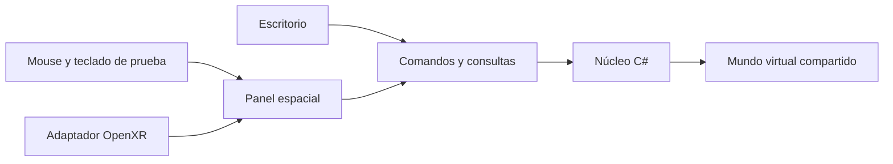

# Cómo está construido

La misma lógica gobierna el robot tanto en escritorio como en la ruta espacial. Cambiar la forma de interactuar no cambia el significado de un punto, una instrucción o una alarma.

## Núcleo

`RobotSimulator.Core` no depende de Godot. Contiene transformaciones/FK, IK local, referencias y puntos, lenguaje de robot, trayectorias, estados y celda. `RobotSimulation` autoriza cada acción; la interfaz no sustituye esas comprobaciones.

Las unidades internas son metros, radianes y segundos. La presentación muestra milímetros y grados. El núcleo usa Z arriba y convierte explícitamente al mundo Godot con Y arriba. La simulación avanza a 60 Hz mediante un único propietario del tick.

`PlanningCoordinator` recibe una copia del proyecto, calcula fuera del hilo de presentación y solo entrega un plan completo vigente. Cambiar datos, cancelar o perder la sesión impide aceptar trabajo obsoleto. `InteractionSession` coordina la fuente de entrada y la habilitación, independiente del dispositivo.

## Presentación e interacción

`JogBridge` conecta comandos y consultas con el núcleo. `RobotWorld` representa las poses y los estados. El panel de escritorio y `SpatialPendant` reutilizan los controles y el mismo borrador de programa.

La superficie espacial convierte rayos en posiciones sobre un SubViewport. Captura, teclado, archivos y controles de celda son compartidos por el emulador y el adaptador OpenXR. Solo el emulador interpreta teclado/mouse como sustitutos de cabeza y manos.

## Datos y límites

Los proyectos son JSON con validación: cargar no mueve el robot ni rearranca, y no elimina alarmas enclavadas. Las colisiones y el agarre son aproximaciones educativas, no dinámica física ni seguridad certificada.

[Arquitectura espacial y contratos de sesión](XR_ARCHITECTURE.md) · [Mapa de reutilización](IMMERSIVE_REUSE_MAP.md) · [Contrato matemático y de lenguaje](M2_M5_CONTRACT.md).
