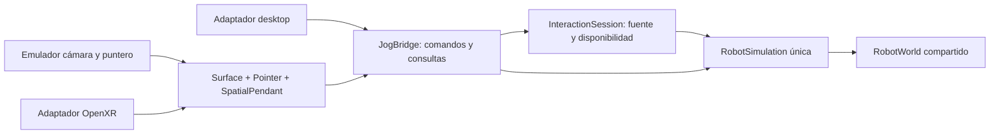

# Arquitectura inmersiva reutilizable

## Flujo y clasificación

Las consultas/órdenes de selección/configuración/enseñanza/edición/ejecución/persistencia son las API semánticas del bridge; componentes UI reutilizados seleccionan datos y editan un solo borrador. Enable/Jog/CartJog atraviesan InteractionSession. Core sigue autorizando y calculando. RobotWorld solo representa poses/estados. Controller es el único tick Step(delta), 60Hz actual; no tick del emulador ni del puntero. Fixtures directos desactivan propietario cuando lo requieren las suites antiguas.

## Contrato de disponibilidad y captura

| Evento | Acción | Restauración |
|---|---|---|
| Habilitación liberada | Enable(false), termina jog | Nueva pulsación explícita |
| Cambio fuente | Cancela entrada y worker; pausa si Running | Soltar/pulsar fuente nueva |
| Navegación/eje/TCP/frame/detalle/teclado | Cancela habilitación/jog | Soltar/pulsar; volver no rearma |
| Rayo sale superficie o se desplaza >18px de captura | Liberación fuera de objetivo y cancela; no ejecuta click cancelado | Soltar gatillo; nueva pulsación |
| Controlador/tracking requerido perdido | Cancela held y planificación pendiente; no pausa un ciclo activo solo por perder controlador | Vuelve tracking, soltar/pulsar; no transferencia |
| Sesión no activa/enfocada | Focus(false) Core: cancela worker/jog y pausa ejecución | Restaurar disponibilidad; nueva Reanudar/Inicio |
| Mirar fuera del panel, con tracking/sesión válidos | Hover cambia; no pierde sesión | No autoriza movimiento por hover |
| Stop/emergencia | Acción Core prioritaria; captura/entrada canceladas | Reset no arranca; Inicio explícito |
| Cierre | Cancela entradas/sesión; bridge dispone worker | No tareas persistentes |

Foco de ventana solo alimenta desktop/emulación. OpenXR usa señales/estado de OpenXRInterface, pose de cabeza y seguimiento de ambos controladores; nunca supone sesión enfocada por ventana. Enable físico separado del gatillo de selección. Captura conservadora no admite drag: scroll explícito/rueda/joystick, valores por teclado virtual. No sliders arrastrables necesarios: click cambia valor. Hover no habilita. Stop/emergencia son excepciones de prioridad del puntero aun si falta la fuente de habilitación; Stop físico del controlador derecho se revisa antes del gate de ambos dispositivos.

## Montajes

Desktop: Lab + cámara orbital + CanvasLayer. Espacial: SpatialLab + el mismo RobotWorld + Surface SubViewport 1280×1000, escala inicial 1.28×1.0m editable. Root estación en metros. Soporte fijo y paneles sin agarrar; mundo no permite arrastrar robot/pieza. El área no usada de Surface es transparente para no tapar robot. PopupMenus embebidos en viewport reciben el mismo rayo. Teclado/detalles a izquierda, seguridad a derecha; tamaño físico y ergonomía iniciales no validados.

Emulación: cámara en estación, mouse→rayo, clic→selección, Espacio→habilitación; botón derecho simula mirar. Sentado/de pie alterna altura observadora y Recentrar restaura. OpenXR: XROrigin3D/XRCamera3D/XRController3D izquierda grip y derecha aim; recenter XRServer conserva inclinación. Offset sentado debe comprobarse en visor; no se modifica referencia del robot. Sin locomoción ni hand tracking.

Mapas candidatos: KHR simple (izquierda select habilita, derecha select selecciona, menu Stop) y Oculus Touch (izquierda squeeze habilita, derecha trigger selecciona, A Stop, thumbstick scroll). Poses grip/aim de ambos. Son bindings sugeridos al runtime, no compatibilidad certificada ni visor escogido. Acción física que no exista en un perfil requiere añadir mapeo probado, no aceptar botones ficticios.

## Plataforma, documentación y renderer

Godot .NET 4.7.2 y net10.0 existentes. Compatibility preservado para desktop y candidato PCVR de este equipo; no cambio global a Vulkan/Mobile sin prueba. XR requiere arrancar con --xr-mode on; mapa res://robot_action_map.tres y shaders XR configurados. Si inicialización falla, adaptador informa XR UNAVAILABLE y no habilita; selector desktop/emulación es decisión explícita. Sin Android autónomo ni dependencias/toolkit/recursos nuevos.

APIs contrastadas con documentación Godot 4.7 y XML del SDK instalado; ResourceSaver generó el mapa real. Se corrigió add_binding inexistente usando property bindings verificada localmente. Fuentes:

- [OpenXRInterface](https://docs.godotengine.org/en/4.7/classes/class_openxrinterface.html)
- [Acciones XR](https://docs.godotengine.org/en/4.7/tutorials/xr/xr_action_map.html)
- [OpenXRIPBinding](https://docs.godotengine.org/en/4.7/classes/class_openxripbinding.html)
- [XRNode3D/tracking](https://docs.godotengine.org/en/4.7/classes/class_xrnode3d.html)
- [SubViewport](https://docs.godotengine.org/en/4.7/classes/class_subviewport.html)
- [XR y renderer/timing](https://docs.godotengine.org/en/4.7/tutorials/xr/setting_up_xr.html)

No interpolación que altere Core implementada. 60Hz de simulación y frame times desktop/emulación son lo medido; presentación estéreo/timing/frecuencia se validan en hardware. Un visor de salón requiere verificar PC/GPU/runtime y perfil, no solo OpenXR.
